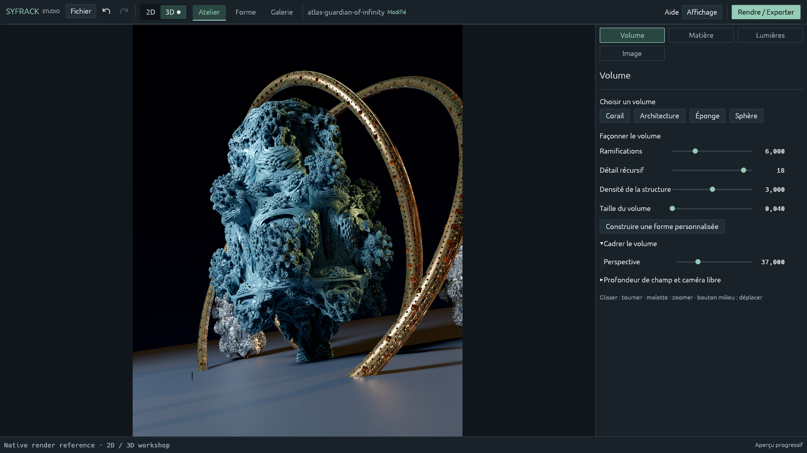

# SyFrack Studio

**L’art fractal, du plan complexe aux mondes monumentaux.**

[English](README.md) · [Guide d’utilisation en anglais](docs/USER_GUIDE.md)

SyFrack est un studio expérimental de création et de rendu de fractales écrit
en Rust. Il propose deux ateliers indépendants : **2D**, pour les motifs du plan
complexe et les flammes fractales ; **3D**, pour les volumes récursifs, les matières,
les lumières et les compositions spatiales.


## Langue de l’interface

L’anglais est utilisé au premier lancement. Choisissez **View → Language →
Français** pour passer au français, ou **Affichage → Langue → English** pour
revenir à l’anglais. Le choix est mémorisé ; il ne modifie ni la scène ni son
historique. Les champs numériques acceptent le point et la virgule.

Les titres personnels, les chemins et les projets existants conservent leur nom.
Les anciens mots-clés français du langage Forme restent acceptés ; le code
exporté utilise désormais un vocabulaire anglais stable.



## Télécharger pour Windows

Dans la page **Releases** du dépôt, téléchargez l’archive
**SyFrack-v…-windows-x64.zip**. Extrayez tout son contenu dans un dossier
accessible en écriture, puis lancez **syfrack-studio.exe**. Studio, la CLI, les
scènes, les graphes et les assets HDRI sont inclus. Rust et Python ne sont pas
nécessaires pour utiliser les exécutables. Conservez `graphs/`, `scenes/` et
`assets/` à côté des exécutables.

Studio nécessite Windows x64 et un GPU/pilote compatible Vulkan ou Direct3D 12.
Ces binaires expérimentaux ne sont pas signés. `SHA256SUMS.txt` permet de vérifier
l’intégrité du ZIP ; il ne constitue pas une signature. Le runtime OIDN reste
facultatif et n’est pas inclus.

## Compiler et démarrer

Windows x64 est la plateforme principalement testée. Installez Rust ainsi que
les outils C++ MSVC. La version de Rust est fixée dans `rust-toolchain.toml`.
Studio utilise Vulkan ou Direct3D 12. Le moteur CLI essaie aussi OpenGL en dernier recours.

À la racine du dossier :

```powershell
cargo build --release --locked --workspace --bins
cargo run --release --locked -p syfrack-cli -- probe
cargo run --release --locked -p syfrack-app --bin syfrack-studio
```

Un script est également fourni :

```powershell
powershell -ExecutionPolicy Bypass -File scripts/build.ps1
```

## Créer et exporter

En 2D, explorez le motif, les couleurs et le cadrage. En 3D, façonnez le volume,
réglez sa matière, placez les sources et développez l’image. L’atelier Forme
donne accès à la construction et au graphe expert.

**Rendre / Exporter** produit un PNG 16 bits, un EXR linéaire brut et un instantané
RON du projet. Les réglages personnalisés comprennent les échantillons, le
nombre de rebonds, la précision géométrique et les limites de calcul. Les rendus
peuvent être mis en pause puis repris depuis leur checkpoint.

Commencez avec une définition modeste. Les volumes récursifs, les matières
transmissives et les nombreux rebonds peuvent demander un calcul long.

## Première version publique expérimentale

Cette version **0.1.0** reste un logiciel en évolution. La compatibilité GPU et
les performances dépendent du matériel. Certains effets volumétriques et le
guidage de lumière indirecte sont expérimentaux. Un checkpoint dépend aussi de
la version du moteur : conservez le binaire correspondant pour une reprise
future. L’EXR brut reste disponible même si le PNG est débruité.

Les sources sont sous [licence MIT](LICENSE). La provenance des panoramas HDRI
et le moteur de débruitage facultatif sont décrits dans
[THIRD_PARTY_NOTICES.md](THIRD_PARTY_NOTICES.md).
