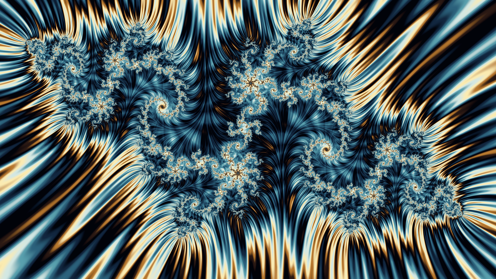
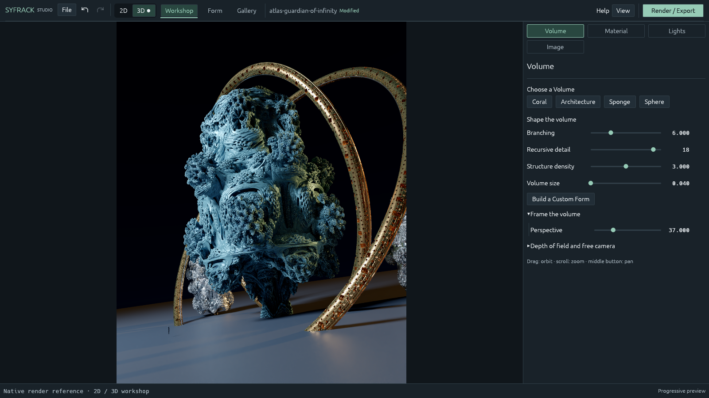

# SyFrack Studio

**Fractal art, from the complex plane to monumental worlds.**

[Français](README.fr.md) · [User guide](docs/USER_GUIDE.md) · [Build from source](docs/BUILDING.md) · [Contributing](CONTRIBUTING.md)



SyFrack is an experimental fractal creation studio and renderer written in Rust.
Compose intricate 2D images, build recursive 3D forms, work with materials and
light, then export a high-quality still with its editable scene.

The **2D** and **3D** workshops keep separate compositions and undo histories.
Start with focused artistic controls, then explore the node graph and advanced
render settings when you need finer control.

## What you can create

- **2D fractals:** Julia, Mandelbrot, Burning Ship, Newton, Nova, Phoenix and
  fractal flames, with orbit colouring, editable palettes and fine filaments.
- **3D forms:** Mandelbulb, Mandelbox, Menger structures, transforms, CSG,
  bounded recursive detail and independently placed copies.
- **Materials and light:** metallic and dielectric surfaces, procedural textures,
  concrete and puddles, area lights, neon tubes, projectors and HDRI environments.
- **Atmosphere:** fog, procedural sky and ocean, and experimental volumetric
  nebulae and fluid studies.
- **Final images:** 16-bit PNG, raw linear EXR and a RON scene snapshot;
  progressive rendering, checkpoints and pause/resume.
- **English and French:** switch instantly under **View → Language**.
  English is the first-launch default; your choice is saved locally.



## Download for Windows

Open this repository's **Releases** page and download the
**SyFrack-v…-windows-x64.zip** asset. Extract the entire ZIP into a writable
folder, then launch **syfrack-studio.exe**. Studio, the CLI, scenes, graph library
and HDRI assets are included. Rust and Python are not required to run it.
Keep `graphs/`, `scenes/` and `assets/` beside the executables.

Windows x64 and a compatible Vulkan or Direct3D 12 GPU/driver are required for
Studio. The executables are unsigned experimental builds. `SHA256SUMS.txt`
provides the archive checksum; it is not a code signature. The optional OIDN
runtime is not bundled. See [Publishing](docs/PUBLISHING.md) for release automation.

## Start from source

Windows x64 is the primary tested platform. You need the Rust toolchain pinned
in `rust-toolchain.toml`, the MSVC C++ build tools and a compatible GPU/driver.
Studio uses Vulkan or Direct3D 12; the CLI additionally tries OpenGL as a fallback. Other platforms
have not been validated for this release; there is no Metal backend selection.

From the repository root:

```powershell
cargo build --release --locked --workspace --bins
cargo run --release --locked -p syfrack-cli -- probe
cargo run --release --locked -p syfrack-app --bin syfrack-studio
```

Or build with `powershell -ExecutionPolicy Bypass -File scripts/build.ps1`.
Keep `graphs/`, `scenes/` and `assets/` alongside a portable installation.
Python 3 is optional for the localization audit and packaging tools.

### Render from the command line

```powershell
cargo run --release --locked -p syfrack-cli -- render scenes/mandelbulb.ron --out renders/my-first-render --width 1280 --height 720 --samples 64 --bounces 4 --steps 512 --denoise
```

Start at a modest resolution. Higher sample counts reduce noise; more bounces
increase indirect light and render time. The advanced controls expose tracing
steps, geometry tolerance, tile limits and batch sizes.

See the [user guide](docs/USER_GUIDE.md) for 2D, 3D, lighting and resume examples.

## Experimental status

This is an early public source release, **0.1.0**. The renderer is under active
development. GPU compatibility, performance and image convergence depend on the
scene and hardware. Volume transport and indirect-light guiding are experimental;
some effects use approximations. This is not a claim of unbiased or spectral
light transport.

Scene files are the portable creative source. Render checkpoints also depend on
the engine/shader version: keep the matching executable when archiving a long
render. Optional denoising changes the PNG, while the raw EXR stays available.

The showcase images are native mathematical renders. They are examples of the
engine's output, not performance guarantees for another machine.

## Explore the source

| Component | Purpose |
| --- | --- |
| `syfrack-app` | Studio interface, document editing, preview and gallery |
| `syfrack-core` | Scene model, graph, validation and CPU fractal evaluation |
| `syfrack-render` | wgpu rendering, shaders, sampling and checkpoints |
| `syfrack-color` | Colour development and image export |
| `syfrack-cli` | Headless rendering and scene/graph tools |
| `syfrack-i18n` | Compiled English/French catalog and language preference |

Read [Architecture](docs/ARCHITECTURE.md) and
[Localization](docs/LOCALIZATION.md) to extend the software.

## License and assets

SyFrack source is licensed under [MIT](LICENSE). Bundled HDRI panoramas retain
their CC0 provenance; see [Third-party notices](THIRD_PARTY_NOTICES.md).
The optional Open Image Denoise runtime is downloaded separately and is not
included in this source tree.
