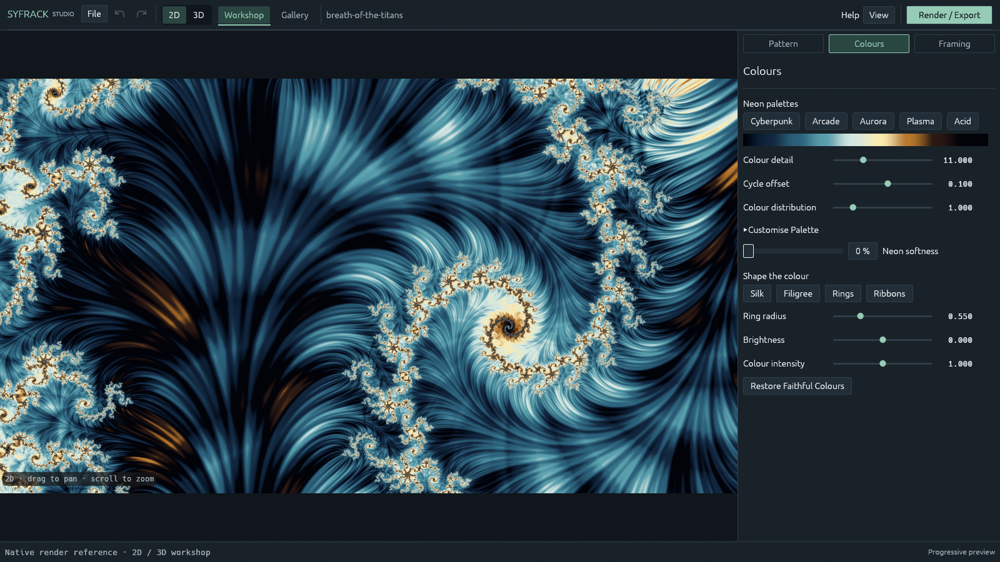

# SyFrack user guide

## Your first session

Launch Studio from the repository root. Open a `.ron` scene with **File → Open**
or pass its path as the first argument to `syfrack-studio`.
For example, `scenes/mandelbulb.ron` is a useful 3D starting point.

Switch between **2D** and **3D** in the command bar. Each workshop retains its
composition, file and undo history during the session. Save the active workshop
before closing. Switching interface language does not save or modify a scene.

Choose **View → Language → English / Français**. The preference is stored in
`%APPDATA%/SyFrack/language.txt` on Windows. `SYFRACK_LANG=en` or `fr` overrides
the saved choice at startup. The catalog is embedded; an internet connection is
not needed for translation.

## 2D: patterns, colours and framing

1. Choose a family: Julia, Mandelbrot, Burning Ship, Newton, Nova, Phoenix, or
   a fractal flame scene.
2. Adjust the mathematical pattern before framing the final composition.
   Changes to the complex constant, power and inversion can transform the image.
3. Choose a palette, adjust its rhythm and phase, then edit individual stops.
   Smooth transitions and cyclic sampling can help continuous colour flow.
4. Drag to pan and scroll to zoom around the pointer. Rotation turns the frame.

The flat canvas samples colour independently of 3D lights. Flame scenes instead
accumulate orbit points, with density-aware reconstruction for their filaments.
For flames, **passes**, **points per pixel per pass**, supersampling and filter
radius are distinct controls. Larger supersampling grids need more RAM; Studio
prevents starting a flame histogram above the engine's 512 MiB grid limit.



## 3D: volume, material, lights and image

Start with a volume family, then adjust recursive detail, folds and proportions.
Use **Form** for construction steps or the expert node graph. The graph provides
primitives, spatial transforms, iteration, traps, CSG and bounded detail.
Names in an existing project are its content and are preserved across languages.

Set base colour, roughness and metallic response in **Material**. Independent
fractal textures can vary colour, roughness and fine relief. Bump and parallax
change surface appearance; they do not add silhouette geometry. Concrete and
puddle patterns are procedural and can be adjusted without external textures.

Add sun, area, neon tube, projector or HDRI lights. Large emitters generally
produce softer shadows. The **Atmosphere** controls include fog and procedural
sea/sky. Volumetric nebulae and fluid preparation are experimental and may be
expensive. **Image** adjusts exposure, tone mapping, colours and neon softness.

Drag to orbit, scroll to zoom, middle-drag to pan. In free-camera mode,
right-drag looks around; WASD or ZQSD moves, E/C moves up/down.
Right-click a surface for focus, orbit centre or light placement actions.

## Final rendering

Open **Render / Export**. Choose resolution, orientation, quality and destination.
Presets are starting points; inspect their sample and bounce counts before a
long job. Studio refuses to overwrite an existing finished render silently.

| Control | Effect |
| --- | --- |
| Samples per pixel | More samples reduce stochastic noise in 3D and improve 2D antialiasing |
| Light bounces | 0 gives direct light; more bounces add indirect transport and reflections |
| Tracing tolerance | Smaller pixel tolerances preserve small geometric openings |
| Tracing steps | Larger limits help deep interiors and difficult recursive surfaces |
| Denoise PNG | Reduces final PNG noise; the raw EXR is preserved |
| Guiding | Experimental learned proposal for indirect light in long renders |
| Tile and batch limits | Control scheduling and update responsiveness, not artistic sharpness |

Final exports contain `name.png` (16-bit), `name.exr` (linear HDR) and `name.ron`
(scene snapshot). Pause preserves a `name.state/` folder. Keep the entire state
folder together and resume with the matching engine build. Increasing quality
in the open editor does not alter the scene embedded in a paused job.

The renderer works in RGB, with approximations for some surface and volume
effects. More samples cannot correct an unsuitable composition, clipped look,
insufficient geometry steps or an approximation's systematic bias.

## Command-line examples

Commands below assume the binaries are on PATH; otherwise use
`target/release/syfrack.exe` on Windows or `cargo run -p syfrack-cli --`.

```text
syfrack probe
syfrack example-scene --kind mandelbulb --out scenes/my-bulb.ron
syfrack render scenes/my-bulb.ron --out renders/my-bulb --width 1280 --height 720 --samples 64 --bounces 4 --steps 512 --pixel-tolerance 0.5 --denoise --checkpoint-every 60 --preview-every 30
syfrack info renders/my-bulb.state
syfrack resume renders/my-bulb.state --out renders/my-bulb
syfrack --help
```

For a safe unattended pause, supply `--pause-file renders/pause-request` when
starting a CLI job, then create that file. The renderer saves its outputs and
checkpoint. Remove the request file before intentionally resuming with the same
option. `--dispatch-ms` changes scheduling latency without changing accumulated
samples; the supported range is 50–800 ms.

The CLI's command names and help are English. `--lang en` / `--lang fr` selects
localized scene diagnostics. Use `--help` on each subcommand for its exact options.

## Shortcuts

| Shortcut | Action |
| --- | --- |
| Ctrl+O | Open project |
| Ctrl+S / Ctrl+Shift+S | Save / Save As |
| Ctrl+Z / Ctrl+Y | Undo / Redo |
| Ctrl+Enter | Render / Export |
| Tab | Image only |
| H | Light handles |
| F1 | Studio help |

Double-click a numeric value for exact entry. Numeric fields accept both a
decimal point and a comma; displayed values follow the selected language.
