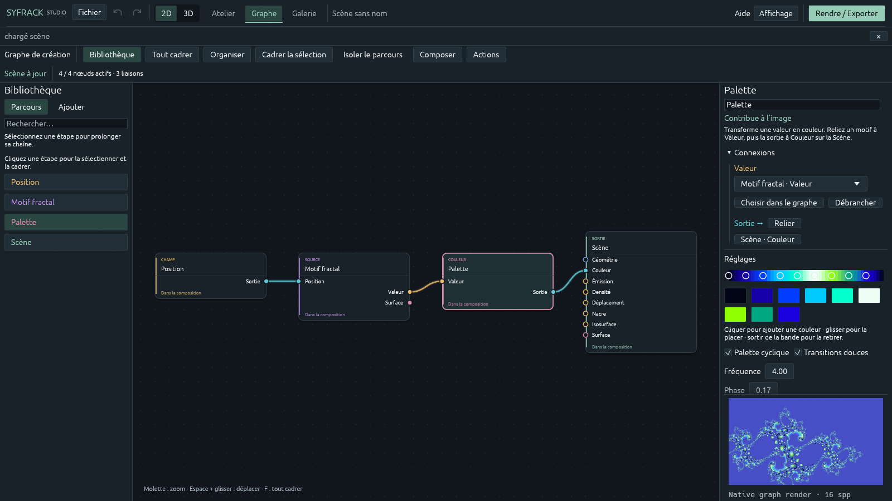
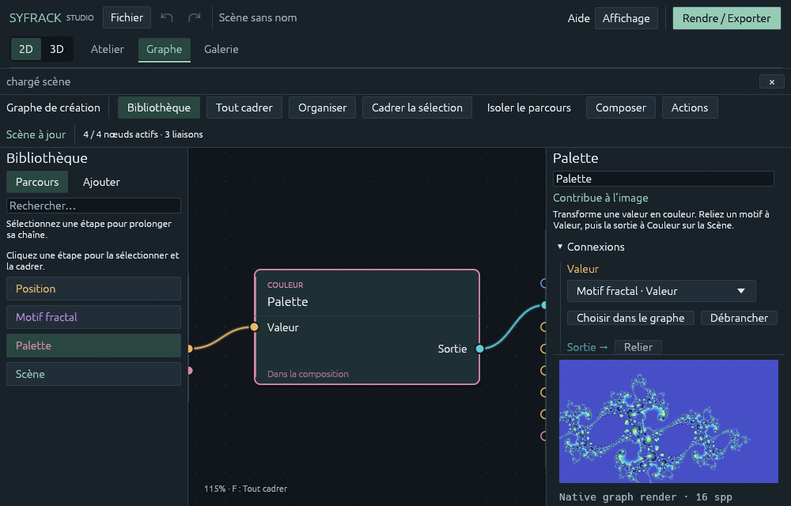

# Atelier nodal — révision du 20 octobre 2026

Cette révision part du graphe unifié existant. Les nœuds restent le document
de création commun à l’aperçu et à l’export. Les calculs de rendu, la précision
des données et les formats de scène sont conservés.



## Composer et retrouver ses étapes

La bibliothèque possède deux onglets :

- **Parcours** recherche les étapes déjà présentes, dans l’ordre d’évaluation.
  Cliquer un nom sélectionne et cadre sa carte. Les étapes qui contribuent à
  l’image sont distinguées des branches non reliées. Les grandes scènes
  s’ouvrent sur un voisinage lisible plutôt que sur des centaines de minuscules
  cartes ; **Tout cadrer** reste disponible.
- **Ajouter** recherche les sources et les traitements. Quand une prise est
  choisie, la liste ne propose que des nœuds raccordables à cette prise.
  Sans prise explicite, l’étape sélectionnée sert de point de départ. Une
  opération à une entrée et une sortie s’insère devant ses consommateurs si
  tous leurs raccordements restent valides. Un raccordement explicite ajoute
  une branche et conserve les consommateurs existants.

Les pastilles **IN** à gauche et **OUT** à droite des noms reprennent les
couleurs des prises du canevas. Plusieurs pastilles indiquent plusieurs types
distincts ; le survol les détaille. Une source sans entrée affiche seulement
ses types de sortie. Les opérations polymorphes tiennent compte de la prise
ou du nœud sélectionné et montrent leurs alternatives sans contexte.

**Composer** ajoute une construction complète : motif → palette → couleur,
deux ondes complexes → somme → intensité → palette, ou flamme → couleur et
densité. Les nœuds existants restent dans le document. Ces constructions
remplacent les seules liaisons de sortie concernées ; **Ctrl+Z** les annule.
La branche de géométrie est conservée, y compris dans une scène 3D.

## Lire et relier

Les cartes distinguent famille, titre, entrées, sorties et participation à
l’image. Les entrées et les sorties occupent des lignes distinctes. Chaque
prise possède la couleur de son type ; les types Point 3D, Distance, Valeur,
Vecteur/couleur, Complexe, Surface et État ne sont pas convertis silencieusement.

On peut cliquer successivement deux prises ou glisser un câble, en commençant
par une entrée ou une sortie. Les prises raccordables sont mises en évidence.
La validation utilise les règles réelles du compilateur, y compris les types
polymorphes et le refus des cycles. **Échap** annule un câble ; le clic droit
sur une entrée débranche sa liaison.

L’inspecteur propose aussi des listes de sources compatibles pour chaque
entrée, avec **Choisir dans le graphe** et **Débrancher**. Les destinataires
d’une sortie sont cliquables. Les connexions de la Scène sont repliées par
défaut pour laisser ses réglages accessibles.

**Isoler le parcours** atténue les branches voisines : on suit les antécédents
et les destinataires de la sélection. Ce mode change uniquement l’affichage.
Il ne désactive aucune contribution au rendu. **Organiser** répartit les étapes
par profondeur, ordonne les branches par balayages barycentriques et tient
compte de la hauteur réelle des cartes. Les corps de boucle occupent des voies
réservées et conservent leur ordre d’évaluation.

Sur une fenêtre étroite, le redimensionnement recadre la sélection pour garder
son titre et ses prises lisibles. Dans un ancien document très dense, utilisez
**Organiser** pour adapter l’espacement à la nouvelle taille des cartes.



| Action | Geste |
| --- | --- |
| Tout cadrer | F |
| Cadrer la sélection | Maj+F, bouton, ou double-clic sur un titre |
| Ouvrir la recherche d’ajout | Maj+A |
| Déplacer la vue | Espace + glisser, ou bouton central |
| Zoomer sous le pointeur | Molette |
| Étendre/réduire la sélection | Ctrl ou Maj + clic sur un titre |
| Dupliquer | Ctrl+D |
| Tout sélectionner | Ctrl+A |
| Supprimer | Suppr |
| Retirer et raccorder les voisins compatibles | Maj+Suppr |
| Annuler / rétablir | Ctrl+Z / Ctrl+Y |

Un retrait avec raccordement concerne les opérations à une entrée et une
sortie. Il ne force aucune conversion entre types ; une branche incompatible
reste débranchée. La sortie Scène est protégée de la suppression.

## Mettre les mathématiques au service de la qualité

La section **Précision de la source** rassemble résolution, budget de points,
pas et durée de simulation. Augmenter l’échantillonnage final ne recrée pas
les détails absents d’un atlas trop grossier. Les paramètres conservés sont
ceux de la scène : cette révision n’abaisse pas automatiquement les budgets.
Les pastilles de palette se répartissent sur plusieurs lignes, et leur simple
affichage conserve exactement les valeurs de couleur enregistrées.
Les motifs analytiques, les orbites, les champs complexes, les simulations,
les palettes et la géométrie native restent raccordables au même moteur.

Les constructions proposées sont des points de départ artistiques. Les
interférences colorées exploitent les opérations complexes déjà présentes ;
elles ne constituent pas une nouvelle simulation physique. Une composition
incomplète reste un brouillon enregistré, tandis que le dernier graphe valide
alimente l’aperçu et l’export.

Les travaux récents suivants ont été consultés pour distinguer les pistes
d’amélioration du moteur des améliorations d’ergonomie livrées ici :

- [ReSTIR-PG, SIGGRAPH Asia 2025](https://research.nvidia.com/labs/rtr/publication/zeng2025restirpg/)
  apprend des distributions de guidage à partir des chemins rééchantillonnés.
  C’est une piste de réduction de variance du transport lumineux, qui demande
  une étude propre au moteur SyFrack et à ses scènes.
- [Gradient-Domain ReSTIR Path Tracing, Eurographics 2026](https://research.nvidia.com/labs/rtr/publication/wang2026gradient/)
  combine estimation des différences entre pixels et réutilisation des
  échantillons. Sa reconstruction et son budget mémoire demandent une
  qualification séparée, notamment pour les détails fractals et les volumes.

Ces deux algorithmes ne sont pas implémentés dans cette révision. Avant toute
intégration, il faut comparer une référence convergée et les résultats à temps
et mémoire comparables : bruit, conservation des détails, stabilité entre
images, biais, et continuité entre les dalles d’export. Leur publication ne
suffit pas à établir un gain sur les scènes et le matériel de SyFrack.

## Vérification

Les règles d’édition sont couvertes par des tests de typage, d’insertion,
de raccordement, de parcours, de disposition et d’annulation. Des gestes de
souris synthétiques exercent le vrai canevas dans les deux sens, y compris
lorsque le destinataire est dessiné avant la source. L’exemple
`studio_capture nodal` produit des captures de l’interface à 1600×900 et
1000×640, avec un rendu GPU natif du graphe de démonstration.

Exemple depuis la racine du dépôt :

```powershell
cargo run --locked -p syfrack-app --example studio_capture -- target/nodal-review/after nodal
```
